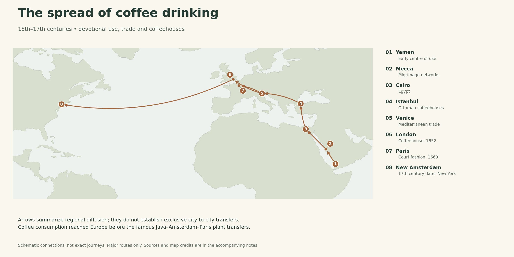
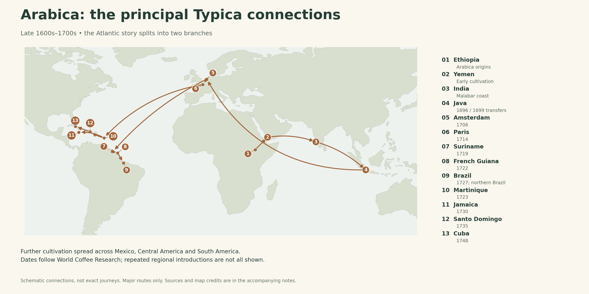
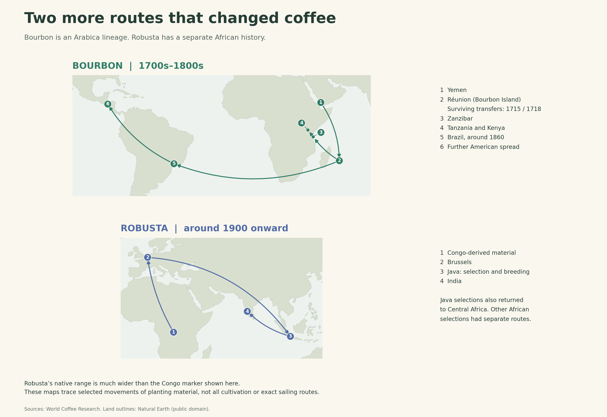

# Coffee’s Journey Around the World

From Ethiopian forests and Yemeni devotional gatherings to plantations across the tropics, coffee became a global crop through trade, migration, botanical exchange and colonial expansion. Its history follows both the movement of plants and the spread of a drinking culture.

## A history of interconnected journeys

Coffee spread through **several overlapping networks**, not one uninterrupted journey. Three things travelled:

- **The habit of drinking coffee:** carried by religious communities, merchants, travellers and migrants.
- **Living plants and viable seeds:** moved to establish cultivation elsewhere.
- **Harvested coffee:** shipped from producing regions to consumers.

A country could import and drink coffee long before anyone grew it there. Botanical gardens could maintain a few plants without becoming commercial coffee-producing regions. Dates below identify particular milestones; they do not always mean the first cup, first plant and first successful plantation all happened together.

The maps show major connections, with simplified arrows rather than literal ship routes. The account covers the principal global migrations and selected regional extensions; it is not a record of every introduction into every country.

## 1. Ethiopia: botanical origins and the Kaldi legend

In the familiar legend, **Kaldi**, an Ethiopian goatherd, notices that his goats become energetic after eating red coffee fruits. In one version, he tells an abbot, who uses a drink made from the fruit to stay awake during prayer. There is no verified eyewitness record establishing Kaldi as coffee's discoverer. The story is best understood as an origin legend rather than a documented discovery. [1]

Arabica's ancestral diversity is concentrated in Ethiopia, with a native range also extending into South Sudan. Yemen became a major centre of domestication. The exact beginning of human coffee use remains uncertain. This Arabica history should not be mistaken for the native-range history of every coffee species. [24]

## 2. Yemen: cultivation, Sufi devotion and Mocha

By the fifteenth century, Yemen was an important centre of coffee growing and use. Sufi communities drank coffee during nighttime prayer and **dhikr**, devotional remembrance of God. Its stimulating effect helped them remain awake. Sufism refers to mystical and devotional traditions within Islam. [1, 3]

Early accounts credit different religious figures with introducing or popularizing coffee. The Sufi connection is stronger historical ground than a claim that one universally agreed person invented the drink. Coffee later spread into ordinary social life and public coffeehouses. [3]

Yemen became the dominant early international supplier. **Mocha/Mokha** was a major Red Sea export port: the name in this historical context refers to a place, not a chocolate drink. Java's growing production later reduced Yemen's commercial dominance. “Monopoly” is useful shorthand for that early concentration of supply, rather than evidence of one company controlling every transaction. [4]

Popular stories about boiling every exported bean to prevent germination should be treated cautiously. The central point is that the establishment of productive plantations elsewhere ended Yemen's exceptional position.

## 3. The drink spreads: the Islamic world, Europe and North America

From Yemen, coffee circulated through **Mecca and other Arabian cities**, then through **Cairo, the eastern Mediterranean and Ottoman lands**. Pilgrimage and trade helped spread the practice. Istanbul had coffeehouses by the mid-sixteenth century. These were places for conversation, news and entertainment as well as drinking coffee. [1, 3]

European uptake followed Mediterranean trade and contact with the Ottoman world. By the seventeenth century, coffeehouses were becoming established in European cities. Coffee also reached New Amsterdam, later New York, in that century. These were developments in consumption, not evidence that coffee was grown commercially in those cities. [1]

Two useful landmarks are **London's first coffeehouse in 1652**, and the **1669 Ottoman diplomatic visit to the French court**, which helped make coffee fashionable in France. The latter precedes the famous Paris botanical-garden plant by decades. [5, 6]

## 4. Yemen → India → Java: the eastward cultivation route

Indian tradition credits **Baba Budan**, a holy man, with bringing seven coffee seeds from Mocha to Karnataka. The Coffee Board of India repeats this tradition, but sources differ on its exact dating. The seven-seed episode remains a traditional origin account; coffee was established in India by the late seventeenth century. [7, 25]

The Dutch moved seeds from India's **Malabar coast to Java in 1696 and 1699**. The resulting planting material is central to the later Typica story. **Batavia means present-day Jakarta, a city on Java, not the island itself.** [8, 9]

India and Dutch-controlled Indonesia were major intermediate stages in coffee’s movement toward Europe. Dutch cultivation also extended to other Asian possessions, including Ceylon, now Sri Lanka, and Sumatra. [11]

## 5. Java → Amsterdam → Paris: the botanical-garden connection

A coffee plant travelled from **Java to Amsterdam in 1706**. In **1714**, Amsterdam's mayor presented a plant to **Louis XIV**. [8]

The king entrusted it to the **Jardin du roi**, now the **Jardin des Plantes**, in Paris. Botanist **Antoine de Jussieu** cared for it, and a heated greenhouse made it possible for the tropical plant to survive and reproduce. The garden was a centre for growing, studying and propagating coffee—not the birthplace of French coffee drinking. [9, 10]

This explains why European botanical gardens appear on a coffee migration map despite Europe's generally unsuitable climate for outdoor commercial coffee cultivation.

## 6. Two Atlantic branches: the Guianas and the Caribbean

The main Typica connections below follow World Coffee Research. Dates describe selected transfers. [8]

| Branch | Selected sequence |
| --- | --- |
| Guianas | Netherlands → **Suriname (1719)** → **French Guiana (1722)** → **northern Brazil (1727)** |
| Caribbean | Paris → **Martinique (1723)** → **Jamaica (1730)**; further transfers to **Santo Domingo (1735)** and **Cuba (1748)** |
| Mainland extensions | Cultivation subsequently spread through Mexico, Central America and parts of South America; repeated introductions complicate any single route |

**Gabriel de Clieu** is associated with the Martinique introduction. His supposed sharing of his drinking-water ration with the plant is a famous story that the Paris museum describes as potentially embellished. The separate Guiana branch matters: not all American coffee can be traced to his one plant. [8, 9]

## 7. Brazil, Colombia and the Latin American expansion

Brazil's agriculture ministry dates the arrival of coffee from **French Guiana at Belém, Pará, to 1727**, associated with **Francisco de Melo Palheta**. Cultivation later expanded south, particularly into the Paraíba Valley, Rio de Janeiro and São Paulo. By the mid-nineteenth century, Brazil was the largest producer. Growing areas, transport infrastructure and export ports developed together. [11]

Colombia followed a different regional history. The Smithsonian describes seeds entering its northeast from **Venezuela in the late eighteenth century**, with commercial cultivation expanding from **1835**. This is a useful example of regional spread within the Americas rather than another direct shipment from Paris. [12]

Across Latin America, coffee's expansion involved many introductions and later replacements of varieties. “Coffee arrived” and “coffee became a major export industry” can be separated by generations. Typica and, later, Bourbon contributed to the foundation of many producing regions. [8, 13]

## 8. The other major Arabica branch: Yemen → Bourbon Island

**Bourbon Island is today's Réunion**, east of Madagascar. It gave its name to the Bourbon variety. French attempts to establish Yemeni coffee there occurred in **1708, 1715 and 1718**; plants from the latter two introductions survived. [2]

Bourbon later spread beyond the island, reaching **Brazil around 1860**, then other parts of South and Central America. This was a second major Arabica expansion, distinct from the Java–Amsterdam–Paris route. [13]

## 9. Cultivated Arabica returns to parts of Africa

During the nineteenth century, missionaries helped carry Réunion-derived coffee through **Zanzibar** to **Bagamoyo in coastal Tanzania** and to missions in **Kenya**. Their planting material contributed to coffee cultivation around Kilimanjaro and the Kenyan highlands. [2]

Calling this a “return to Africa” describes particular cultivated lineages travelling back to the continent. It does **not** mean that Africa lacked coffee until Europeans brought it: Ethiopia retained its own coffee traditions, and other African regions had native coffee species and local uses. The Bourbon-related plants in East Africa also should not all be assumed to be genetically identical to the named Bourbon variety grown in Latin America. [13, 14, 24]

## 10. Disease changes the map: Ceylon, Liberica and Robusta

**Coffee leaf rust**, caused by the fungus *Hemileia vastatrix*, devastated Asian Arabica production in the late nineteenth century. The major Ceylon epidemic is commonly dated to **1869**. The collapse of coffee there helped drive the island's transition toward tea. Rust also spread through the Indian Ocean region. [15]

Growers sought alternatives. **Liberica**, from tropical West Africa, was one attempted replacement. **Robusta**, commonly used for cultivated *Coffea canephora*, became much more important during the twentieth century. Its expansion was helped by productivity, suitability for warmer environments and resistance to some major disease pressures. Resistance does not mean immunity. [14, 16]

Robusta has a **separate African origin**, across a broad tropical range from Guinea toward Uganda and Angola. Around the turn of the twentieth century, Congo-derived seeds went to **Brussels and then Java**. Java became an important selection and breeding centre; material moved onward to **India** and was later sent back to **Central Africa**. Other African selections also entered cultivation independently. [14]

This is another reason the history cannot be reduced to Ethiopia → Yemen → the entire world: Robusta's international expansion followed its own routes.

## 11. Further connections in Asia and the Pacific

| Region | Historical connection | Significance |
| --- | --- | --- |
| **Philippines** | Lipa's city history reports seeds brought from **Mexico in the 1740s** by a Franciscan friar | A trans-Pacific connection; popular accounts differ on the earliest date. [17] |
| **Hawaiʻi** | A significant shipment of plants came from **Brazil in 1825**, associated with Chief Boki and John Wilkinson | Coffee crossed the Pacific through more than one introduction; this was not necessarily the first attempt. [18] |
| **Vietnam** | First planting is dated to **1857** in the World Bank's history | Its much later Robusta boom, especially in the **1990s**, reflects policy, investment and agricultural expansion as well as the original introduction. [19] |
| **Yunnan, China** | Introduced in the **late nineteenth century**; larger-scale production around Baoshan developed from **1952** | Introduction and commercial expansion were separate stages. [20] |
| **Papua New Guinea** | Jamaica's **Blue Mountain** material was introduced and developed at **Wau in the late 1920s** | One documented planting-material connection, not a claim that every PNG coffee descends from it. [21] |

## 12. The people behind the arrows

The maps show where plants moved; they do not show who did the work or controlled the land. **Colonial power, coerced labour and slavery were central to parts of coffee's expansion.**

In Java, Dutch authorities imposed compulsory coffee cultivation and deliveries. The nineteenth-century **Cultivation System**, often called *Cultuurstelsel* or *tanam paksa*, intensified extraction, while coercive coffee production in Priangan had earlier roots. Brazil's nineteenth-century coffee plantations relied heavily on enslaved Africans and their descendants. These systems differ historically, but neither should disappear behind a romantic story of adventurous travellers carrying seedlings. [22, 23]

Farmers and local communities also selected plants, developed cultivation practices and built regional coffee cultures. Following a European ship or botanical garden explains a transfer; it does not give a complete account of the people who made cultivation possible.

## 13. What the migration history explains

The history helps explain why **Mocha, Java, Bourbon and Blue Mountain** appear in coffee language: they preserve connections to ports, islands, lineages or growing regions. They are not all the same kind of label.

It also explains why countries far apart can grow related Arabica varieties. Many internationally cultivated Arabicas descend from a relatively narrow set of introductions, while Ethiopian diversity and later breeding add other histories. Modern movement of planting material continues through research and breeding; the historical routes are foundations, not the final genetic family tree. [25]

## Sources and image credits

Sources checked on 18 October 2026. Historical “firsts” can be disputed. The chronology distinguishes traditional stories, selected documented transfers and later commercial expansion. The source notes below identify the basis of each section rather than implying that every source agrees on every date.

1. National Coffee Association, [History of coffee](https://www.aboutcoffee.org/origins/history-of-coffee/).
2. World Coffee Research, [History of Arabica](https://varieties.worldcoffeeresearch.org/arabica-2/history-of-arabica).
3. Encyclopaedia Iranica, [Coffee](https://www.iranicaonline.org/articles/coffee-ar/).
4. Ib Friis, [Coffee and qat on the Royal Danish expedition to Arabia](https://doi.org/10.3366/anh.2015.0283), *Archives of Natural History* (2015).
5. Horniman Museum and Gardens, [How our most loved food came to the UK](https://www.horniman.ac.uk/story/how-our-most-loved-food-came-to-the-uk/).
6. The Metropolitan Museum of Art, [Coffeepot by Jean-Baptiste Vallot, 1744–45](https://www.metmuseum.org/art/collection/search/200119), historical commentary on French coffee drinking.
7. Coffee Board of India, [About us](https://coffeeboard.gov.in/aboutus.aspx), Baba Budan tradition. Its dating differs from other histories.
8. World Coffee Research, [Typica](https://varieties.worldcoffeeresearch.org/varieties/typica).
9. Muséum national d'Histoire naturelle, [Le café, une histoire liée à celle du Jardin des Plantes](https://www.mnhn.fr/fr/le-cafe-une-histoire-liee-a-celle-du-jardin-des-plantes).
10. Muséum national d'Histoire naturelle, [Le Jardin royal des plantes médicinales (1626–1718)](https://www.mnhn.fr/fr/le-jardin-royal-des-plantes-medicinales-1626-1718).
11. Brazil, Ministry of Agriculture, [Café no Brasil e Ementário do Café](https://www.gov.br/agricultura/pt-br/assuntos/politica-agricola/cafe/cafeicultura-brasileira), Brazilian chronology.
12. Smithsonian Folklife Festival, [Café: De la Semilla a la Taza de Café](https://festival.si.edu/2011/colombia/coffee/en-espanol/smithsonian).
13. World Coffee Research, [Bourbon](https://varieties.worldcoffeeresearch.org/varieties/bourbon).
14. World Coffee Research, [History of Robusta](https://varieties.worldcoffeeresearch.org/robusta-2/history-of-robusta).
15. Stuart McCook and John Vandermeer, [The Big Rust and the Red Queen: Long-Term Perspectives on Coffee Rust Research](https://doi.org/10.1094/PHYTO-04-15-0085-RVW), *Phytopathology* (2015); see also the American Phytopathological Society's [Coffee rust lesson](https://www.apsnet.org/edcenter/pdlessons/Pages/CoffeeRust.aspx).
16. Royal Botanic Gardens, Kew, [A high extinction threat for wild coffee could rattle the sector](https://www.kew.org/read-and-watch/high-extinction-threat-coffee), historical species replacement.
17. City Government of Lipa, [Local history](https://lipa.gov.ph/history/).
18. University of Hawaiʻi Press, [From Boki's Beans to Kona Coffee](https://manifold.uhpress.hawaii.edu/read/migrant-ecologies/section/328441c1-5956-4b2c-a831-511ca5df03c7), in *Migrant Ecologies*.
19. World Bank, [The Coffee Sector in Vietnam](https://documents1.worldbank.org/curated/en/458011468172449689/pdf/293580VN0Coffe1ver0P08262901Public1.pdf), especially the historical perspective section.
20. FAO, [Development of GI-protected Baoshan Arabica coffee in Xinzhai village](https://www.fao.org/one-country-one-priority-product/asia-pacific/good-practices/detail/coffee-xinzhai-baoshan-yunnan-china/en).
21. Coffee Industry Corporation, [Papua New Guinea Coffee Handbook, second edition](https://www.cic.org.pg/wp-content/uploads/2021/08/52029_CIC-Handbook.pdf), section 3.2.1, PDF page 40.
22. Tania Murray Li, [The Price of Un/Freedom: Indonesia's Colonial and Contemporary Plantation Labor Regimes](https://www.cambridge.org/core/journals/comparative-studies-in-society-and-history/article/price-of-unfreedom-indonesias-colonial-and-contemporary-plantation-labor-regimes/8EFC43C76E9427735F4CD38C7037CCF5), *Comparative Studies in Society and History* (2017).
23. [African Diaspora, Slavery, and the Paraiba Valley Coffee Plantation Landscape](https://www.jstor.org/stable/40241714), historical research on Brazilian coffee and slavery.

24. [Unveiling a unique genetic diversity of cultivated Coffea arabica L. in its main domestication center: Yemen](https://link.springer.com/article/10.1007/s10722-021-01139-y), *Genetic Resources and Crop Evolution* (2021).
25. [The genome and population genomics of allopolyploid Coffea arabica reveal the diversification history of modern coffee cultivars](https://pmc.ncbi.nlm.nih.gov/articles/PMC11018527/), *Nature Genetics* (2024).

**Images:** Three original explanatory maps accompany this article. Land outlines are from [Natural Earth](https://www.naturalearthdata.com/), whose map data are [public domain](https://www.naturalearthdata.com/about/terms-of-use/). Historical connections are synthesized from the cited sources: culture map [1, 3, 5, 6]; Typica map [2, 8, 9, 11]; Bourbon/Robusta maps [2, 13, 14]. All arrows are schematic connections, not reconstructed voyages. The culture map's arrows summarize regional diffusion, not exclusive city-to-city transfers.
