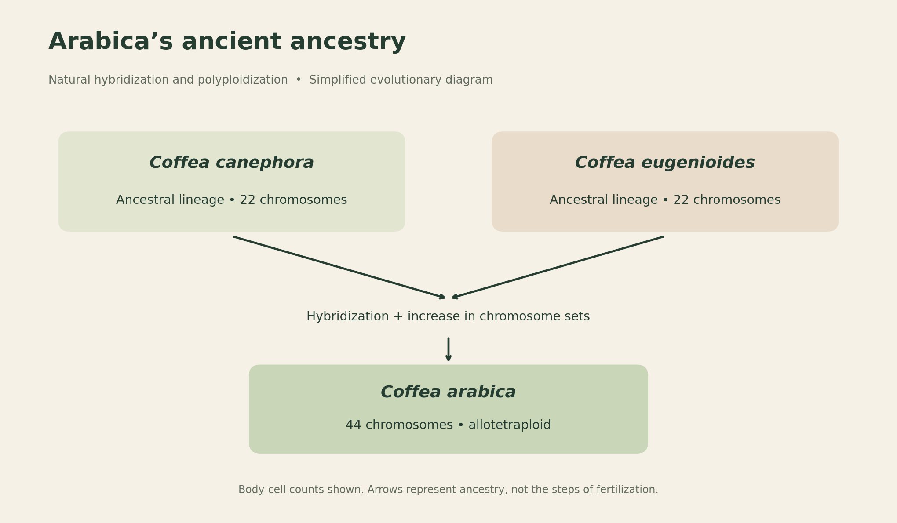
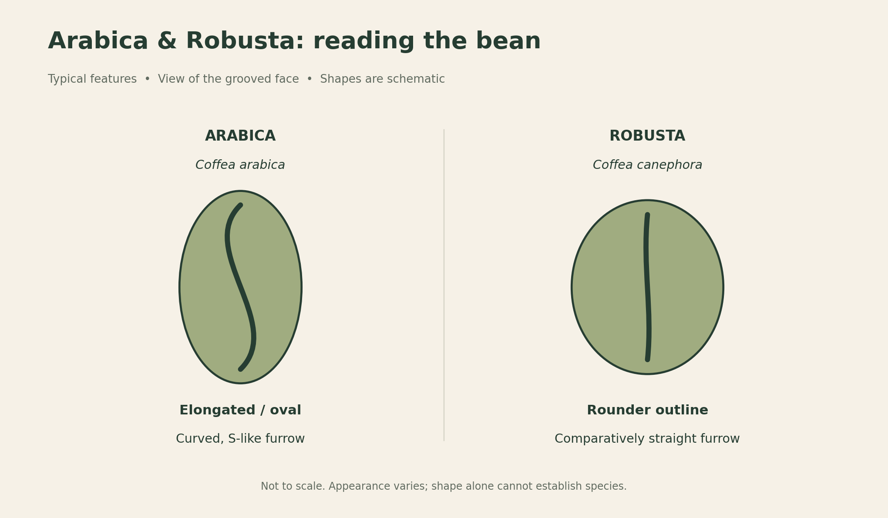

# Coffee Plant Taxonomy: Arabica, Robusta, and Their Ancestry

Coffee appreciation begins with the plant. Arabica and Robusta are familiar names on coffee bags, but they also point to differences in ancestry, chromosomes, growing conditions, and the seeds that eventually become a beverage.

## Discovery, scientific naming, and evolutionary origin

These are three different timelines. A plant can exist for hundreds of thousands of years, be familiar to local communities for generations, and receive a scientific name much later.

The date **850 AD** is associated with popular retellings of the Kaldi and dancing-goats legend. It is not an established date for the discovery of Arabica. The story belongs to coffee folklore; the identity of the first person to recognize or use coffee is unknown.[1]

For botanical naming, the documented dates are clearer:

| Plant | Scientific name | First publication of the accepted name |
| --- | --- | --- |
| Arabica | *Coffea arabica* L. | **1753**, by Carl Linnaeus |
| Robusta | *Coffea canephora* Pierre ex A.Froehner | **1897** |

These publication dates record scientific naming, not first human knowledge of the plants.[2][3] Consequently, “Robusta was discovered in 1850” should not be treated as a definitive milestone. Its African history predates its formal botanical description and later international cultivation.[4]

## How plant taxonomy works

**Taxonomy** names and groups organisms. Its ranks move from broad groups to increasingly specific ones: kingdom, phylum or division, class, order, family, genus, and species. Additional ranks, such as subclass, can sit between them.

The table below follows the classification used by Kew’s *Plants of the World Online*. Both Arabica and Robusta share the same ranks through genus, then separate at species.[2][3]

| Rank | Classification | Meaning in this example |
| --- | --- | --- |
| Kingdom | Plantae | The plant kingdom |
| Phylum | Streptophyta | The lineage containing land plants and their closest green-algal relatives |
| Class | Equisetopsida | A broadly defined land-plant class in this system |
| Subclass | Magnoliidae | The flowering-plant group in this system |
| Order | Gentianales | An order of flowering plants |
| Family | Rubiaceae | The coffee family |
| Genus | *Coffea* | The genus containing coffee species |
| Species | *Coffea arabica* or *Coffea canephora* | Two distinct species within the genus |

Different references may use different names or ranks for the higher plant groups. Modern descriptions also use unranked evolutionary groups such as angiosperms, eudicots, and asterids. A hierarchy should therefore be read as one consistent classification system, rather than assembled from several systems.

### Genus, species, and common names

In *Coffea arabica*, **Coffea** is the genus and **arabica** is the specific epithet. Together, the two words form the species name. The genus starts with a capital letter, the epithet uses lowercase, and both are italicized. After the first mention, the genus can be shortened: *C. arabica*.

**Robusta** is the familiar commercial name associated with *Coffea canephora*. The accepted species name is *C. canephora*, although the name *C. robusta* occurs in older literature as a synonym.[3] The genus contains many other species, including *C. eugenioides*; Arabica and Robusta are the two cultivated most widely worldwide.[4][5]

## Arabica’s natural hybrid ancestry

Arabica originated through ancient natural hybridization between ancestors of **Coffea canephora** and **Coffea eugenioides**, accompanied by polyploidization—an increase in the number of chromosome sets. This happened in the wild, long before modern coffee breeding.[6]

*A schematic of evolutionary ancestry, not a literal diagram of fertilization. Chromosome counts refer to ordinary body cells.*

A 2024 genomic study estimated the founding polyploidization event at approximately **350,000–610,000 years ago**. This is an evolutionary estimate, not an exact date.[6]

The basic chromosome set in these coffees contains 11 chromosomes. *C. canephora* and *C. eugenioides* are **diploid**, with two sets: **2n = 2x = 22**. Arabica is **allotetraploid**, with four sets derived from two ancestral species: **2n = 4x = 44**.[7]

The word *allotetraploid* combines two ideas: “allo” refers to the different ancestral species, while “tetraploid” refers to four chromosome sets. The counts do not measure flavor quality or caffeine strength.

## Arabica and Robusta compared

The comparison below describes broad tendencies. Individual varieties and growing environments can differ substantially.

| Characteristic | Arabica | Robusta |
| --- | --- | --- |
| Species | *Coffea arabica* | *Coffea canephora* |
| Chromosomes in body cells | 44; allotetraploid | 22; diploid |
| Pollination | Self-compatible; predominantly self-pollinating, but can cross-pollinate | Generally self-incompatible; requires compatible pollen from another plant |
| Bean outline | Usually elongated or oval | Usually rounder |
| Central groove or furrow | Often curved, resembling an S | Often comparatively straight |
| Typical favorable elevation | About 700–2,200 m | About 0–900 m; higher cultivation is possible |
| Typical favorable annual mean temperature | About 16–24°C | About 21–30°C |
| Caffeine in dried beans, reported range | About 0.6–1.7% | About 1.5–3.3% |
| Common cup tendencies | More pronounced acidity and varied aromas | Often fuller-bodied and more bitter, with lower perceived acidity |
| Coffee leaf rust | Many traditional varieties are susceptible | Generally more resistant; resistance varies |

Sources: chromosomes [7]; pollination [8]; bean form, climate, and broad sensory tendencies [9]; caffeine and leaf-rust background [10].

**Elevation is a guide to climate, not a biological boundary.** Latitude, shade, rainfall, and local temperature affect where each species can thrive. The ranges above are general reference values, not universal farming recommendations.[9]

The caffeine figures describe bean composition, not caffeine per cup. Dose, brewing method, and serving size also affect the amount in a drink. Likewise, the species name alone cannot establish quality: cultivation, harvesting, processing, roasting, and brewing all influence the result.

## Recognizing the bean: shape and furrow

The **furrow**, also called the center cut or groove, is the line on the flatter face of a coffee seed. In a typical side-by-side comparison, Arabica looks more oval with a curved groove, while Robusta looks rounder with a straighter groove.[9]

*Simplified illustrations, not photographs or a size comparison. The curves are emphasized for clarity.*

These features are useful clues rather than a reliable identification test. Bean shape varies, and processing and roasting change its appearance. A curved groove does not prove that a bean is Arabica, and a round bean does not automatically mean Robusta. Botanical identity is best established through reliable origin and variety information, with laboratory methods available when verification is needed.

## Sources

1. National Coffee Association. [History of coffee](https://www.aboutcoffee.org/origins/history-of-coffee/). Historical uncertainty and the Kaldi legend.
2. Royal Botanic Gardens, Kew. [*Coffea arabica* L.](https://powo.science.kew.org/taxon/747038-1), *Plants of the World Online*. Accepted name, publication date, and classification.
3. Royal Botanic Gardens, Kew. [*Coffea canephora* Pierre ex A.Froehner](https://powo.science.kew.org/taxon/747068-1), *Plants of the World Online*. Accepted name, publication date, synonyms, and classification.
4. World Coffee Research. [History of Robusta](https://varieties.worldcoffeeresearch.org/robusta-2/history-of-robusta). African origins and cultivation history.
5. World Coffee Research. [What’s included in the varieties catalog](https://varieties.worldcoffeeresearch.org/about-the-catalog/whats-included). Species and cultivated varieties.
6. Salojärvi, J. et al. (2024). [The genome and population genomics of allopolyploid *Coffea arabica* reveal the diversification history of modern coffee cultivars](https://doi.org/10.1038/s41588-024-01695-w). *Nature Genetics*. Arabica’s ancestry and estimated age.
7. World Coffee Research. [Coffea Arabica Genome](https://worldcoffeeresearch.org/resources/coffea-arabica-genome). Chromosome sets and hybrid origin.
8. [Genetic variability for vigor and yield of robusta coffee (*Coffea canephora*) clones in Ghana](https://pmc.ncbi.nlm.nih.gov/articles/PMC9400079/) (2022). Chromosome counts and reproductive biology.
9. International Trade Centre (2021). [The Coffee Guide, fourth edition](https://www.intracen.org/sites/default/files/uploadedFiles/intracenorg/Content/Publications/ITC_Coffee_4th_Report_20210930_web_pages.pdf), chapter 5, table 2, p. 148. Comparative traits and growing conditions.
10. PROSEA. [*Coffea* L.](https://prosea.prota4u.org/view.aspx?id=91), *Plant Resources of South-East Asia*, handbook 16. Bean composition and botanical background; historical production figures are not used here.

The figures accompanying this article are original educational schematics based on the cited sources.
