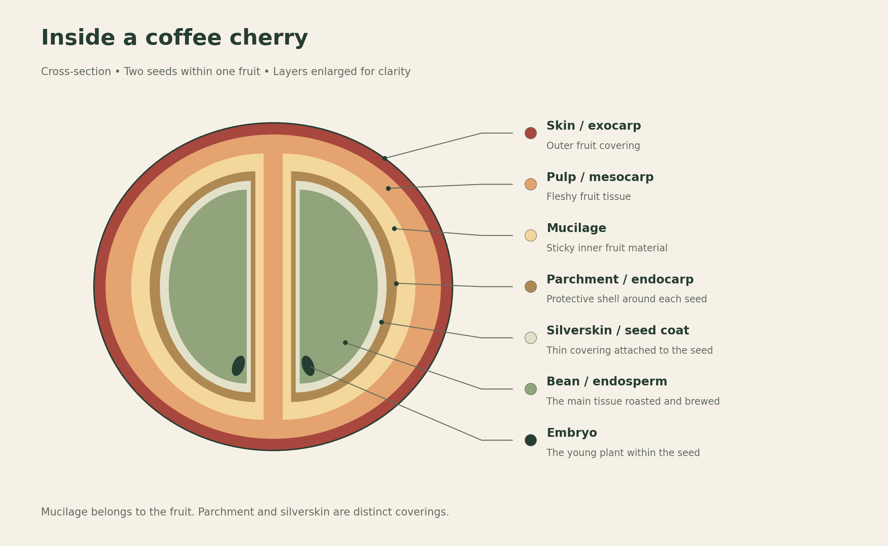
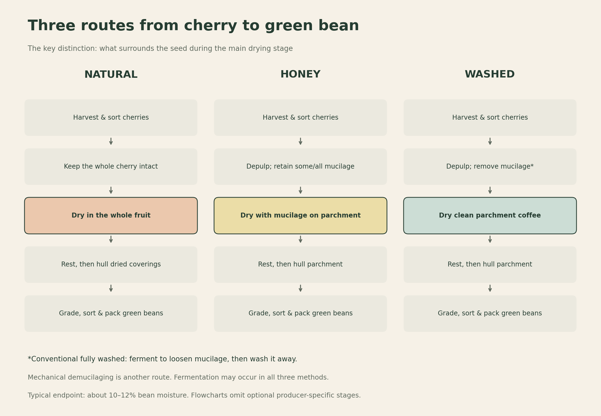

# Coffee Processing: From Ripe Cherry to Green Bean

A coffee bean is a seed inside a fruit. Processing separates that seed from the surrounding fruit and prepares it for storage, transport, and roasting. The timing of fruit removal—and the way fermentation and drying are managed—helps shape the coffee’s eventual flavor.

## What determines coffee’s taste?

Processing is one influence in a longer chain. The same variety can taste different when grown, processed, roasted, or brewed differently.

| Factor | How it influences the cup |
| --- | --- |
| **Species and variety** | Genetics influence the seed’s composition and its potential flavor characteristics. |
| **Microclimate** | Local temperature, rainfall, humidity, sunlight, and shade affect fruit development and ripening. |
| **Elevation and location** | Elevation often influences temperature; latitude, slope, and exposure also matter. Altitude alone does not guarantee quality. |
| **Soil and farm management** | Nutrient availability, water supply, plant health, and cultivation practices affect the crop. |
| **Ripeness and harvesting** | The maturity and condition of the cherries entering processing influence uniformity and quality. |
| **Processing and fermentation** | Fruit removal, microorganisms, time, temperature, and oxygen exposure affect flavor development. |
| **Drying and storage** | Drying conditions, moisture, packaging, and storage time influence how well quality is preserved. |
| **Roasting** | Heat transforms the seed’s chemistry and develops much of coffee’s familiar aroma. |
| **Brewing and water** | Grind, ratio, temperature, contact time, water composition, and filtration affect what reaches the cup. |

World Coffee Research’s variety trials demonstrate interactions between genetics and environment: a variety’s performance can change across growing locations. Its researchers also identify processing, storage, and roasting as important influences on cup evaluations.[1] The FAO discusses site and cultivation factors; brewing introduces another set of variables.[3][17]

## Harvesting: timing and methods

### Why do harvest seasons differ between hemispheres?

“September–December in the north, April–August in the south” is a useful starting approximation for some origins, but it is too narrow to serve as a worldwide calendar.

Many northern origins harvest late in one year and into the early months of the next. Many southern origins harvest around the middle of the year. The underlying sequence is **seasonal weather → flowering → fruit development → harvest**. Rain following a dry period often triggers flowering; cherries then need several months to mature.[4]

Earth’s axial tilt produces opposite seasonal cycles in the two hemispheres, but tropical coffee responds strongly to local wet and dry seasons. In Brazil, for example, September–October rains can lead to harvests beginning around May–June. Colombia’s different rainfall patterns and growing regions support harvests across the year; one farm is not necessarily harvesting continuously.[4]

Elevation, variety, and yearly weather shift these windows. The relevant calendar is therefore the **farm or region’s harvest season**, rather than hemisphere alone.

### Selective picking and picking all cherries

For quality-focused coffee, producers often use **selective picking**: workers pick only ripe cherries and return later for those still ripening. This takes more time and labor but helps create a more uniformly ripe lot.[5][15]

For lower-cost, high-volume production, **strip picking** removes all cherries from a branch together, potentially mixing ripe, unripe, and overripe fruit. It is faster and can be done by hand or machine. Quality also depends on how evenly the fruit ripens and how carefully it is sorted afterward, so strip picking does not automatically mean poor coffee.[15]

## Inside the coffee cherry

*Original educational schematic. Layer thicknesses and seed proportions are exaggerated for clarity.*

| Part | What it is | Why it matters in processing |
| --- | --- | --- |
| **Skin / exocarp** | The fruit’s outer covering | Removed early in honey and washed processing; retained during natural drying. |
| **Pulp / mesocarp** | The fleshy fruit beneath the skin | Most is removed by a pulper in honey and washed methods. |
| **Mucilage** | The sticky, sugar- and pectin-containing inner fruit material around the parchment | Retained in varying amounts for honey; removed before the main drying stage in washed coffee. |
| **Parchment / endocarp** | The protective shell around each seed | Usually remains during honey and washed drying, then is removed by hulling. |
| **Silverskin / seed coat** | A thin covering attached to the seed | Some remains on green coffee; much separates as chaff during roasting. |
| **Bean / endosperm** | The main storage tissue of the seed | The part predominantly roasted and brewed. |
| **Embryo** | The small living plant inside the seed | Can develop into a new coffee plant under suitable conditions. |

Most cherries contain two seeds.[6] Mucilage is part of the fruit tissue, not a coating added during processing.[7]

**Depulping and hulling are different operations.** Depulping removes fresh skin and much of the pulp. Hulling removes dried coverings: the dried fruit husk and parchment in naturals, or principally the parchment in washed and honey coffees.[15][16]

## Three processing methods at a glance

The clearest distinction is **what remains around the seed during the main drying stage**:

- **Natural / dry process:** the whole cherry remains intact.
- **Honey / pulped natural:** skin and most pulp are removed; some or all mucilage remains on the parchment.
- **Washed / wet process:** skin, pulp, and mucilage are removed; the seed dries in parchment.[15][16]

*Typical routes. Producers may add fermentation stages or use different equipment.*

### Sorting and moisture: shared principles

Cherries are sorted to remove debris and separate unsuitable fruit. **Water flotation** is one useful sorting step: low-density, damaged, or dried cherries may float. Floating is not a perfect ripeness or quality test, and sinking does not guarantee a sound cherry. Keep fractions separate and assess them. Flotation is common, but it is not mandatory for every natural process.[2][7]

A typical endpoint is approximately **10–12% moisture in the bean, on a wet-weight basis**. For example, 12% means 12 g of water in 100 g of the measured coffee—not 12% moisture in the intact fruit as a whole.[7] The beans may still be enclosed in dried cherry or parchment when tested using the appropriate sampling and measurement procedure.

Drying time is a guide, not an endpoint: weather, airflow, layer depth, turning, and equipment change how quickly a lot dries.

## 1. Natural processing: drying the whole cherry

1. **Harvest ripe cherries.** Separate damaged and unsuitable fruit.
2. **Sort and clean.** Use hand sorting, flotation, or other appropriate separation methods; drain after flotation.
3. **Dry the intact cherries.** Spread on clean patios or raised beds, turning regularly and protecting against rain and rewetting. Fermentation occurs within the fruit during drying; a separate tank stage is optional.
4. **Check the bean’s moisture.** Around **14–30 days** is an illustrative drying window, not a required duration. Continue until the measured endpoint is reached.
5. **Rest and condition the dried coffee.** Store appropriately to allow moisture to become more even through the lot.
6. **Hull the dried cherries.** Remove the dried skin, pulp/mucilage residues, and parchment to release green beans.
7. **Grade, sort, and pack.** Remove remaining defects and foreign material before storage or shipment.[2][8][16]

Conventional naturals do **not** require a fresh-fruit depulping step after drying followed by a separate obligatory parchment-hulling step. A dry mill removes the dried coverings; machinery arrangements can vary.

Naturals often show pronounced fruit character and a fuller body. Poorly managed drying can produce unwanted fermentation or mold defects.[8]

## 2. Honey processing: drying with mucilage

1. **Harvest and sort ripe cherries**, using flotation where appropriate.
2. **Depulp promptly.** Remove the skin and much of the flesh while retaining mucilage on the parchment.
3. **Choose how much mucilage to retain.** Equipment settings and, where used, mechanical demucilaging control this; depulping and mucilage removal are not the same operation.
4. **Dry the mucilage-covered parchment.** Manage layer depth, airflow, shade, and turning. Sticky coffee can clump and dry unevenly.
5. **Measure moisture and condition the lot.** Use the same bean-moisture principle as the other methods.
6. **Hull, grade, and pack.** Remove parchment and dried residues, then sort the green coffee.[7][9]

**Honey is not added.** The name refers to the sticky fruit material. *Honey*, *pulped natural*, and *semi-dry* describe closely related practices, but local usage differs; a producer’s actual protocol is more informative than the label alone.[7][9]

### White, yellow, red, black—and pink honey

These are **producer-dependent descriptions, not internationally fixed grades**. Retained mucilage, drying speed, shade, and handling can all influence the name. Universal tables assigning an exact percentage or number of drying days to every color are misleading.[9][10]

| Label | Common interpretation | Possible cup tendency—not a guarantee |
| --- | --- | --- |
| **White honey** | Most mucilage removed; comparatively close to washed processing | Cleaner, lighter fruit expression |
| **Yellow honey** | Some mucilage retained, often with relatively faster drying | Gentle fruit character and perceived sweetness |
| **Red honey** | Often more retained mucilage and/or slower, partly shaded drying | More pronounced fruit and rounded texture |
| **Black honey** | Often extensive mucilage retention and carefully managed slower drying | Deeper fruit expression and fuller texture |
| **Pink honey** | A less standardized, producer-specific designation | Cannot be predicted from the name alone |

The first four descriptions reflect common industry usage, with considerable overlap.[10] **Pink should not automatically be inserted between yellow and red.** For example, Zanya in Vietnam explicitly describes “pink honey” as its own name for parchment coloration and specifies an 80-hour whole-cherry fermentation before depulping and mucilage-on drying. That is one producer’s recipe, not a definition for all pink honey coffees.[11]

Darker honey is not automatically sweeter or better. Ask how much mucilage remained, whether a separate fermentation occurred, and how drying was controlled.

## 3. Washed processing: removing mucilage before drying

The following describes a conventional fermented, fully washed route:

1. **Harvest, sort, and clean ripe cherries.** Separate unsuitable fruit and debris.
2. **Depulp.** Remove skin and most pulp; the seeds remain in parchment with mucilage attached.
3. **Ferment to loosen the mucilage.** Hold the pulped coffee in tanks, with or without added water. Time varies with temperature, microorganisms, and the desired endpoint; published examples span roughly **12–72 hours**.
4. **Wash away the loosened mucilage.** Clean water and agitation or washing channels remove the remaining sticky material. Some systems also separate density grades here.
5. **Dry the clean parchment coffee.** Use beds, patios, or suitable dryers; turn and monitor it until the target bean moisture is reached.
6. **Rest and store in parchment.** Protect the dried coffee from moisture and odors.
7. **Hull, grade, and pack.** Remove parchment and sort the green beans for shipment.[12][16]

Mechanical demucilagers can replace or shorten the fermentation stage in some washed systems. A separate post-wash soaking stage is used in some origins but is not universal.[7][12]

“Washed” does not mean fermentation-free. It also does not mean **wet-hulled / giling basah**, in which parchment is removed while the bean is still relatively wet; that is a different route.[2]

## How processing can change the cup

| Attribute | Natural | Honey / pulped natural | Washed |
| --- | --- | --- | --- |
| Common flavor expression | Ripe fruit, berry, dried fruit; sometimes wine-like | Fruit, caramel-like sweetness, sometimes jammy or nutty notes | More clearly separated flavors; floral, citrus, or other fruit notes depending on the coffee |
| Body / texture | Often fuller or syrupy | Often rounded or silky | Often lighter or more delicate, though substantial body is possible |
| Perceived acidity | Sometimes softer or less prominent | Often balanced with fruit and sweetness | Often more distinct or bright |
| Main processing challenge | Slow or uneven whole-fruit drying | Sticky mucilage and uneven drying | Managing mucilage removal, water quality, and drying |

These are recurring sensory tendencies, not diagnostic rules.[8][9][12] A natural can be clean and bright, and a washed coffee can be sweet and full-bodied. “Clean” describes clarity and freedom from unwanted taints; it does not mean that a washed coffee is inherently superior.

Fermentation occurs across all three methods: microorganisms transform compounds in the fruit. The presence of mucilage does not, by itself, establish how much sugar ends up in the bean or how sweet the drink will taste.[7] Processing labels describe a route; they do not specify every fermentation condition or guarantee a particular flavor.

## Decaffeinated coffee: removing caffeine before roasting

Decaffeination is an additional treatment of **green coffee before roasting**. It can follow natural, honey, or washed processing. Beans are moistened, most caffeine is extracted, and the coffee is dried again.

| Method | Basic process |
| --- | --- |
| **Water process** | Water or a coffee extract draws caffeine out of the beans. Activated-carbon filters remove caffeine from the liquid while helping retain other coffee compounds; Swiss Water is a familiar example. |
| **Solvent process** | Ethyl acetate or methylene chloride selectively dissolves caffeine, either from the beans or from a water extract. The solvent is subsequently removed. |
| **Carbon dioxide process** | Pressurized CO₂ extracts caffeine from moistened beans; the caffeine is separated and the CO₂ can be reused. |

The aim is to remove caffeine while preserving as much flavor as possible. **Decaf is not necessarily completely caffeine-free**, and its taste still depends on the original coffee, decaffeination, and roasting.[18][19]

## Primary defects in green coffee

Defects can originate on the tree or develop during harvesting, processing, drying, and storage. Sorting reduces their presence but does not replace careful handling.

The established SCA Arabica classification lists six **Category 1 / primary defects**. “Full” black or sour and “severe” insect damage are specific categories; partial discoloration and slight insect damage are classified separately.[13]

| Primary defect | What to recognize | Why it matters |
| --- | --- | --- |
| **Full black** | A bean with extensive black discoloration | Can introduce bitter, dirty, or phenolic character. |
| **Full sour** | A substantially yellowish-to-brown discolored bean associated with deterioration | Can produce pungent, sour, or unwanted fermented character. |
| **Severe insect damage** | Extensive holes or tunneling in the seed | Damages the bean and can provide sites for further deterioration. |
| **Fungus damage** | Visible fungal growth or characteristic affected areas | Indicates deterioration; mold can develop during drying or storage. |
| **Foreign matter** | Stones, sticks, metal, or other non-coffee material | Contaminates the lot and may damage equipment. |
| **Dried cherry / pod** | A whole dried cherry remaining among the green beans | Indicates incomplete separation and can contribute off-flavors or uneven roasting. |

The category names follow the SCA form; descriptions and effects are summarized from the Coffee Guide and FDA examination guidance.[2][13][14] Exact grading requires the relevant reference standard rather than casual visual diagnosis.

**A “sour bean” defect is not the same as pleasant coffee acidity.** A bright citrus-like cup can be sound, while a deteriorated sour bean is a physical quality defect. Equally, a dried cherry is normal during natural processing; it becomes a defect when it remains in a lot sold as hulled green coffee.

## Sources

1. World Coffee Research (2024). [Evaluating cup quality in global Arabica variety trials](https://worldcoffeeresearch.org/news/2024/cup-quality-gxe-imlvt). Genetics, environment, and post-harvest influences.
2. International Trade Centre (2021). [The Coffee Guide, fourth edition](https://www.intracen.org/sites/default/files/uploadedFiles/intracenorg/Content/Publications/ITC_Coffee_4th_Report_20210930_web_pages.pdf), chapter 5, especially pp. 167–175. Processing, conditioning, milling, and defects.
3. National Coffee Association. [Brewing](https://www.aboutcoffee.org/brewing/). Preparation variables.
4. Royal Coffee / Chris Kornman (2024). [Harvest & Arrival: A Roaster’s Guide to Coffee Seasons](https://royalcoffee.com/blogs/blog/harvest-arrival-a-roasters-guide-to-coffee-seasons). Flowering, rainfall, and regional harvest patterns.
5. SCOPI. [Pelatihan Budidaya Berkelanjutan dan Pascapanen Kopi Arabika, second edition](https://scopi.or.id/storage/NSC%20Arabika%20Edisi%202_SCOPI.pdf). Indonesian harvesting terminology and post-harvest practices.
6. National Coffee Association. [What is coffee?](https://www.aboutcoffee.org/origins/what-is-coffee/). Cherry anatomy.
7. TechnoServe (2022). [Coffee Wet Mill Processing Guide](https://www.technoserve.org/wp-content/uploads/2022/03/TechnoServe-Wet-Mill-Processing-Guide.pdf). Fruit layers, sorting, moisture, and washed processing.
8. Cafe Imports. [Natural Process](https://www.cafeimports.com/north-america/natural-process). Whole-fruit drying and sensory tendencies.
9. Cafe Imports. [Honey Process](https://www.cafeimports.com/australia/blog/honey-process/). Mucilage retention and terminology.
10. DRWakefield / Jamie Treby (2023). [A closer look at Honey Processing methods](https://drwakefield.com/news-and-views/a-closer-look-at-honey-processing-methods/). Common honey color descriptions.
11. Zanya. [Pink honey](https://wiki.zanyacoffee.com/pink-honey). A producer’s explicitly nonstandard name and specific processing protocol.
12. Cafe Imports. [Washed Process](https://www.cafeimports.com/north-america/blog/washed-process/). Fermentation, washing, drying, and sensory tendencies.
13. Specialty Coffee Association. [Coffee Value Assessment forms](https://www.scith.coffee/wp-content/uploads/2025/04/SCA-CVA-Cupping-forms.pdf), physical assessment, Alpha V1, September 2023 (SCA document hosted by SCI). Used for the Category 1 and 2 defect taxonomy, not as a claim about the latest assessment edition.
14. U.S. Food and Drug Administration. [Macroanalytical Procedures Manual: Beverages and Beverage Materials](https://www.fda.gov/food/laboratory-methods-food/mpm-v-1-beverages-and-beverage-materials). Examination of insect damage, mold, and extraneous material.
15. National Coffee Association. [Lifecycle of Coffee](https://www.aboutcoffee.org/origins/lifecycle-of-coffee/). Harvesting and the basic processing routes.
16. FAO (2005). [Arabica coffee manual for Lao PDR: Harvesting and processing](https://www.fao.org/4/ae939e/ae939e08.htm). Drying, moisture inside parchment, storage, and milling; its historical quality judgments are not adopted here.
17. FAO (2005). [Arabica coffee manual for Lao PDR: Coffee plant and site selection](https://www.fao.org/4/ae939e/ae939e03.htm). Growing conditions and crop quality.

18. Specialty Coffee Association. [Coffee Decoded: The Chemistry of Decaffeination](https://sca.coffee/sca-news/coffee-decoded-21-chemistry-of-decaf). Solvents, carbon dioxide, and carbon filtration.
19. National Coffee Association. [Decaf coffee](https://www.aboutcoffee.org/beans/decaf-coffee/). Decaffeination before roasting and residual caffeine.

Both illustrations are original educational schematics based on the cited processing and anatomy references.
