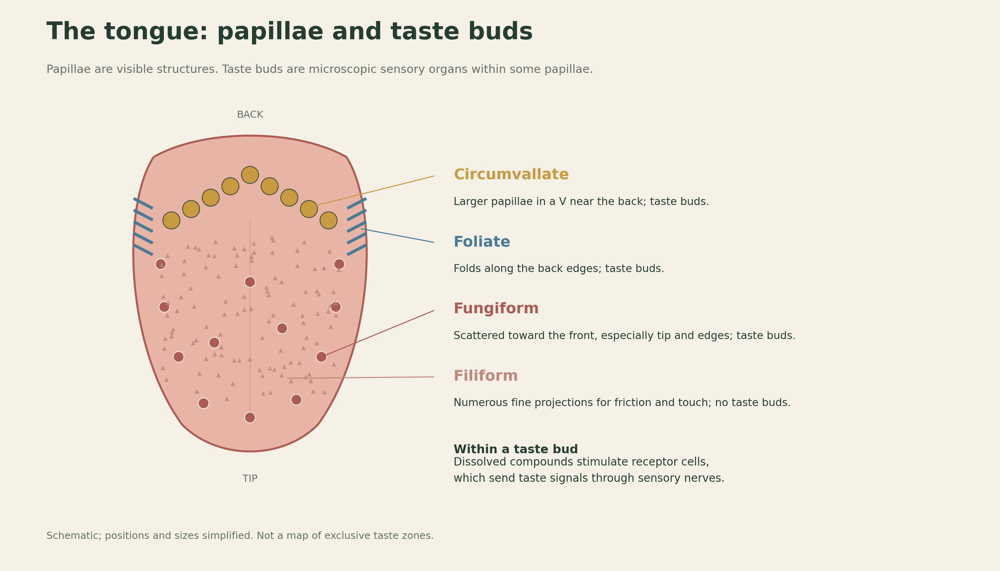
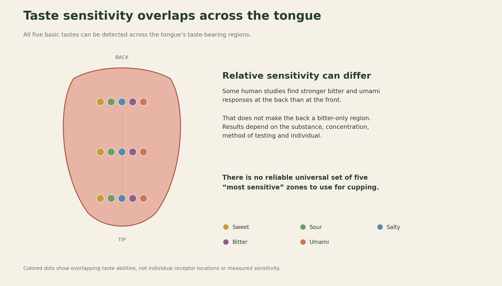
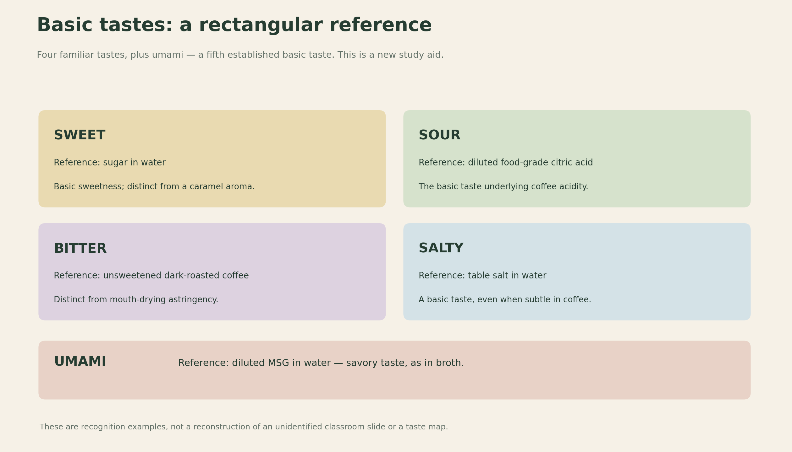
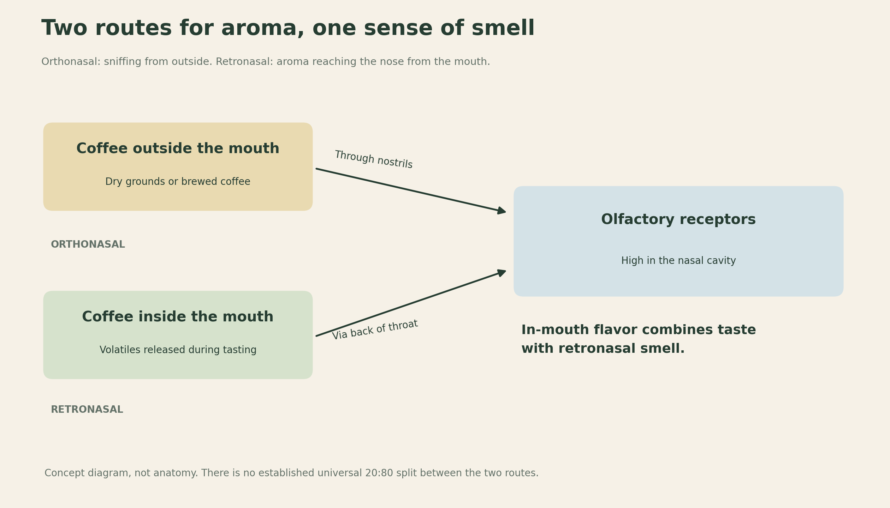
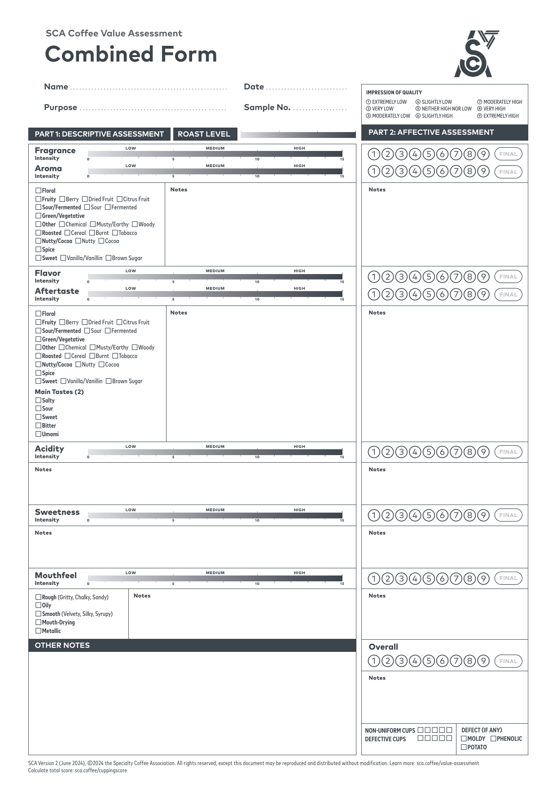
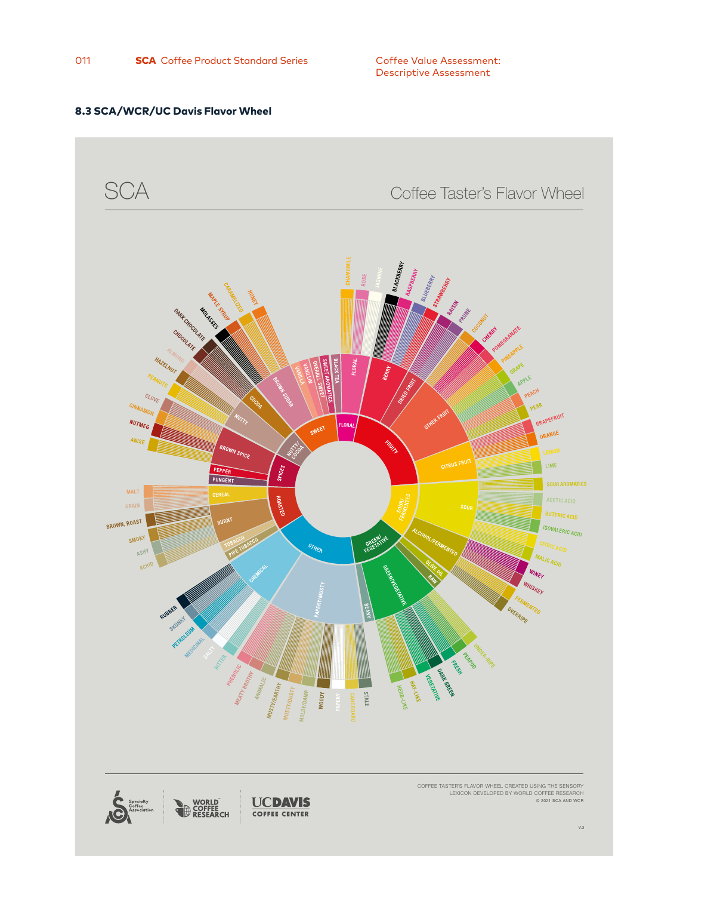
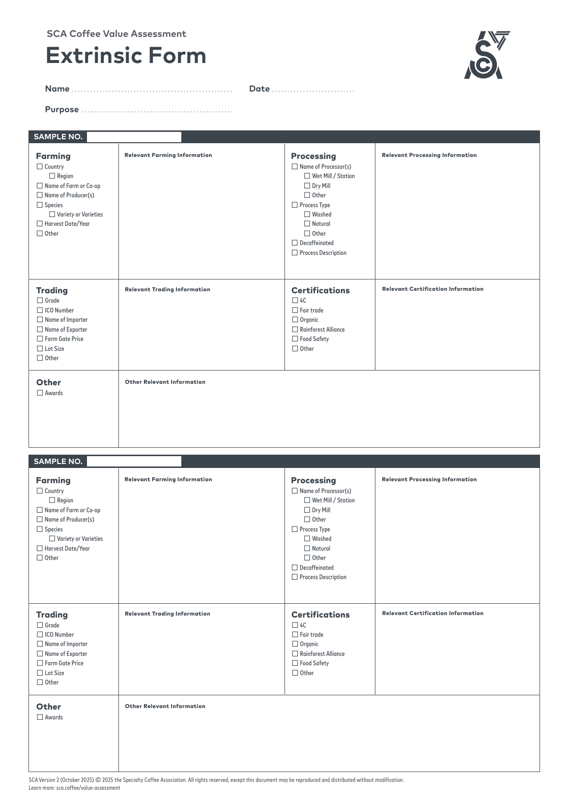

# Coffee Cupping: Understanding Taste, Aroma, and Coffee Value

Cupping makes coffee easier to compare. By preparing samples consistently and examining them in a deliberate sequence, tasters can distinguish what a coffee is like from how much they value it. The process connects sensory observation—smelling, tasting, and feeling—with a vocabulary that other people can understand.

This article follows the Specialty Coffee Association’s Coffee Value Assessment (CVA), including the **Combined Form, Version 2, June 2024**, and the separate **Extrinsic Form, Version 2, October 2025**. Preparation details were checked against SCA-102-2024; descriptive, affective, and extrinsic guidance against SCA-103-2024, SCA-104-2024, and SCA-105-2025. These are the editions linked from SCA’s resources at the time of review, 27 October 2026.[1]

## 1. What is cupping?

**Cupping is a structured method of sensory assessment:** coffee samples are prepared under comparable conditions, then examined for their smell, flavor, aftertaste, acidity, sweetness, and mouthfeel. Multiple independently prepared cups also reveal inconsistencies within a sample.

### Ted R. Lingle’s definition

The definition commonly attributed to **Ted R. Lingle**, author of *The Coffee Cupper’s Handbook*, emphasizes systematically evaluating a coffee sample’s aroma and taste characteristics. The central idea is repeatable observation, rather than simply deciding whether a drink is enjoyable. This is a paraphrase of the definition attributed to Lingle by coffee educators; it is not presented as a verified quotation from a specific handbook edition.[2]

### Hasbean Coffee’s explanation

Hasbean became **Ozone Coffee** in March 2024. Ozone’s current explanation describes cupping as preparing and tasting coffees side by side while keeping the conditions consistent, so that their differences are easier to recognize. This is the current explanation from Hasbean’s successor, rather than a claimed verbatim reconstruction of an older Hasbean slide.[3][4]

For example, comparing a delicate floral coffee with a nutty, full-bodied coffee is more informative when both use the same bowls, water, dose calculation, and tasting sequence. Otherwise, a difference in preparation can masquerade as a difference in the beans.

## 2. How the tongue, nose, and mouth perceive coffee

### Papillae and taste buds

The visible projections on the tongue are called **papillae**; singular, *papilla*. Taste buds are much smaller sensory organs containing taste receptor cells. Some papillae contain taste buds, while others primarily support touch and friction.[5]

| Papilla type | Typical location | Role |
| --- | --- | --- |
| **Fungiform** | Scattered across the front of the tongue, particularly the tip and edges | Contain taste buds; also participate in oral sensation. |
| **Circumvallate**, or vallate | A V-shaped arrangement near the back | Contain many taste buds along their walls. |
| **Foliate** | Folds at the back edges | Contain taste buds. |
| **Filiform** | Numerous fine projections across much of the upper surface | Help with friction and touch; **do not contain taste buds**. |

### Does each taste have its own area?

**There are no exclusive sweet, sour, salty, bitter, or umami zones.** Taste-bearing regions can respond to all five basic tastes. The familiar diagram that assigns sweetness to the tip and bitterness to the back is misleading.

Regional differences do exist, but they do not justify a fixed five-zone map. One human study found stronger bitter and umami responses at the back than at the front, but no regional difference for sweet, salty, or sour under its test conditions. Other work shows that regional responses depend on the particular bitter compound and the testing method.[6][7]

For cupping, let the liquid spread comfortably through the mouth. There is no need to aim it at a special “acidity zone” or “sweetness zone.”

### Five basic tastes—not just four

Older introductory teaching often lists sweet, sour, salty, and bitter. **Umami**, a savory taste, belongs alongside them. “Acid” names a class of substances; **sourness** is the basic taste they can produce.[8]

*This rectangular chart is a new study aid. The unidentified classroom rectangle cannot be reconstructed reliably from its shape alone.*

| Basic taste | Familiar reference | What to distinguish |
| --- | --- | --- |
| Sweet | Sugar dissolved in water | Basic sweetness versus a sweet-associated aroma such as vanilla. |
| Sour | Diluted food-grade citric acid; the sour component of lemon | Sour taste versus lemon’s aroma. |
| Bitter | Unsweetened dark-roasted coffee | Bitterness versus the drying sensation of strong tea. |
| Salty | Table salt dissolved in water | Saltiness versus a vague description such as “mineral.” |
| Umami | Diluted monosodium glutamate (MSG); savory broth | Umami versus saltiness; broth may contain both. |

Food examples contain several sensations at once. They are memory aids, not chemically pure equivalents.

### Taste versus flavor

**Taste**, or gustation, is the response to dissolved substances through the taste system. **Flavor** is the integrated experience of taste and smell; in the CVA flavor section, the relevant smell is **retronasal olfaction**. Mouthfeel and temperature also shape the wider drinking experience, although the form separates mouthfeel for assessment.[9]

A jasmine-like coffee illustrates the distinction: its floral identity comes mainly from aroma, while sourness, bitterness, or sweetness belong to taste. “Jasmine” is not a sixth basic taste, nor does it mean jasmine was added to the coffee.

There are two routes by which aroma molecules reach the olfactory receptors:

| Route | Path | Coffee example |
| --- | --- | --- |
| **Orthonasal** | From outside, through the nostrils | Sniffing dry grounds or the brewed coffee. |
| **Retronasal** | From the mouth through the passage behind it into the nasal cavity | Recognizing a floral or fruity character while tasting and breathing out. |

The term is **retronasal**, not “netronasal.” There is **no established universal 20:80 split** between retronasal and orthonasal perception. Claims that a fixed percentage of flavor comes from smell also oversimplify a context-dependent experience.[10]

### Is spiciness a taste—or an actual burn?

Chili heat is **chemesthesis**: chemicals activate sensory nerves involved in irritation, heat, and pain. Capsaicin activates the heat-sensitive receptor TRPV1, producing a burning sensation without needing to raise the food’s temperature. That sensation is not, by itself, proof of a thermal burn.[11]

In coffee, a **spice aroma** and **pungent heat** are different observations. A cinnamon-like aroma belongs in the aromatic description; an actual peppery sting belongs to the physical sensation. A coffee can smell of cloves or cinnamon without feeling hot or irritating.

## 3. Reading the SCA Coffee Value Assessment

The CVA has **four complementary assessments**: physical, descriptive, affective, and extrinsic. Physical assessment examines the material coffee—for example, moisture, size, and green-bean defects. The other three are the focus here.[1]

| Assessment | Question | Example |
| --- | --- | --- |
| **Descriptive** | What is perceived, and how strong is it? | Medium acidity; citrus-like flavor; light, smooth mouthfeel. |
| **Affective** | What impression of quality does it create? | The taster values the clear citrus character highly. |
| **Extrinsic** | What information is known beyond tasting the coffee? | Named producer, variety, process, and certification. |

The **Combined Form contains Part 1: Descriptive and Part 2: Affective**. Extrinsic assessment is on a separate form; it is not a printed “Part 3” on this Combined Form.

*Official form ©2024 Specialty Coffee Association, reproduced without changes to its content. Click the image to enlarge. The form permits unmodified reproduction and distribution.*

[Download the official forms PDF](assets/sca-cva-forms.pdf) · [SCA’s current resource page](https://sca.coffee/value-assessment)

### Intensity, character, and quality are different

**Intensity means perceived strength—not speed of detection.** Detection threshold, how quickly a sensation appears, and how long it lasts are separate ideas.

The descriptive scales run **0–15**. They record the strength of each section, such as the total fragrance or acidity. The **CATA** checkboxes—*check all that apply*—record character. In this context, “quality” can mean *what kind of sensation*, not *how good it is*. Good or bad judgments belong in the affective assessment.[12]

Consider two invented examples:

| Observation | Descriptive record | Affective judgment |
| --- | --- | --- |
| A faint but attractive floral fragrance | Low intensity; floral character | Could receive a high quality rating. |
| A powerful burnt aroma | High intensity; burnt character | Could receive a low quality rating. |

Neither strength nor the number of descriptors is a quality score.

For CVA, “all that apply” still has selection limits: choose **up to five** descriptors in each shared aromatic list, **up to two main tastes**, and **up to two mouthfeel descriptors**. Use notes for greater precision.[12] The two-taste limit explains the emphasis on “two stronger tastes”: it is a recording rule, not a claim that coffee contains only two tastes.

## 4. Part 1: Descriptive assessment

### 4.1 Fragrance: smelling the dry grounds

**Fragrance** is the smell of the ground coffee before water is added. Grinding exposes more surface area, making released volatile compounds easier to smell. Evaluate it promptly and compare the cups consistently.

Ask: Is the fragrance faint or strong? Does it suggest flowers, nuts, fruit, cocoa, toasted cereal, or something else?

An example note might be: “Moderate fragrance; hazelnut and cocoa.” This records intensity and identity without yet deciding whether the fragrance is desirable.

### 4.2 Aroma: smelling after water is added

**Aroma**, as a named cupping section, is the smell of the wetted coffee. Assess the undisturbed surface and the vapors released when the crust is broken. Dry fragrance and wet aroma are both orthonasal observations, but they need not smell identical.[4]

Heat, water, extraction, and the release of volatile compounds change what reaches the nose. A nutty dry fragrance may develop a fruitier wet aroma. Record that change instead of assuming one observation invalidates the other.

On the Combined Form, fragrance and aroma have separate intensity scales but share one descriptor list. Notes can clarify which impression occurred at which stage.

### 4.3 Flavor: describing the coffee in the mouth

Flavor combines the basic tastes with retronasal aroma. Start with broad, defensible descriptions, then become more specific if the association is clear.

For example:

- “Fruity” may become “citrus-like,” then “orange-like.”
- “Nutty” may become “roasted almond-like.”
- “Floral” may remain simply “floral” if a particular flower is uncertain.

Specificity should reflect recognition. Writing “floral” confidently is more useful than guessing a flower because someone else named it.

#### The SCA Coffee Taster’s Flavor Wheel

*SCA/WCR/UC Davis Coffee Taster’s Flavor Wheel, shown as a full-page render of SCA-103-2024, Appendix 8.3. The artwork retains its printed ©2021 SCA and WCR credit. SCA publishes the wheel under [CC BY-NC-ND 4.0](https://creativecommons.org/licenses/by-nc-nd/4.0/); its content is reproduced without modification. See the [official wheel and license page](https://sca.coffee/store/flavor-wheel).*

Read the wheel **from the center outward**: broad families lead to narrower descriptions. It supplies a shared vocabulary, not a requirement to find every note or an instruction to award higher scores to certain colors. Its foundation is the WCR Sensory Lexicon, which provides definitions and reference materials for training.[13][14]

#### Enzymatic, sugar browning, and dry distillation

These are traditional coffee-aroma teaching groups. They can help organize memory, but they are not three chemically exclusive categories and are not the CVA’s current top-level descriptor list. The older teaching system also distinguishes **aromatic taints**.[15]

| Traditional group | Useful associations | More accurate interpretation |
| --- | --- | --- |
| **Enzymatic** | Floral, fruity, some fresh vegetal notes | A historical grouping connected to the bean’s biological development and processing. It does not mean that all floral aromas are simply “organic acid + sugar.” |
| **Sugar browning** | Caramel-like, nutty, chocolate-like, toasted notes | Roasting generates many aromas. Maillard reactions involve reducing sugars and amino compounds; caramelization is a different set of sugar reactions. |
| **Dry distillation** | Smoky, woody, pungent or strongly roasted associations | Historical language associated with thermal breakdown during roasting. “Fiber becomes every earthy or chemical note” is too simple. |
| **Aromatic taints** | Examples include musty or medicinal off-notes | Not every undesirable aroma comes from dark roasting; growing, processing, storage, and contamination can also matter. |

Roasting involves overlapping reactions and many precursors.[16] An aroma label is not a laboratory diagnosis of its cause. Likewise, “earthy” is not automatically a formal defect, and a smoky note’s desirability depends on context and intensity.

### 4.4 Aftertaste: what remains

**Aftertaste** is the flavor remaining after the coffee is swallowed or spat out. Describe three aspects separately:

| Aspect | Question | Example |
| --- | --- | --- |
| Intensity | How strong is the remaining sensation? | Faint versus pronounced. |
| Duration | How long does it persist? | Quickly fading versus lingering. |
| Character and appreciation | What remains, and is it pleasant? | Lingering cocoa; persistent burnt bitterness. |

The form’s descriptive aftertaste line records **intensity**, not seconds. Duration and identity can go in the notes; the affective rating records the impression of quality. A long aftertaste is not automatically better—a brief pleasant finish can be preferable to a persistent unpleasant one.

Example: “Moderate aftertaste intensity; orange-like flavor fades first, followed by a longer cocoa-like finish.”

### 4.5 Acidity: strength and character

Coffee acidity is the perception of sourness in the context of the whole cup. Its **intensity** and its **desirability** are different: bright acidity can be attractive, while equally strong acidity may seem harsh in another coffee.

“Sweet acidity” and “dry acidity” can be classroom shorthand, but they are not official CVA acid classes. Make the intended sensations explicit:

| Shorthand | Clearer description |
| --- | --- |
| **Sweet, fruit-like, bright acidity** | Sourness accompanied by ripe-fruit or sweet-associated flavor; for example, an orange-like impression. |
| **Dry, green, herbal acidity** | Sourness accompanied by green/herbal aroma and possibly mouth-drying astringency. These are separate observations. |

A green aroma is not itself a type of acid, and astringency is not sourness. A useful note is: “High acidity; green-apple-like flavor; drying finish.” That is more informative than “dry acid.”

**Perceived acidity is also not a direct pH reading.** Acid composition, concentration, buffering, and the surrounding flavors all matter. Identifying a fruit-like note does not prove which acid is responsible.[17]

### 4.6 Sweetness: simple, complex, and changing with temperature

The perception of sweetness in black coffee can involve both taste and aroma associations. Recent research found that aroma contributed to perceived sweetness, while measured sugars in the tested coffees were below ordinary sweetness-detection thresholds. This does not mean sweetness is imaginary or entirely aromatic; its causes are more complicated than “the beans contain sugar.”[18]

The following terms are useful ways to write notes, **not official CVA sweetness grades**:

| Term | Practical meaning | Example |
| --- | --- | --- |
| **Simple** | One clear sweet-associated impression | Mainly brown-sugar-like. |
| **Complex** | Several distinguishable sweet-associated impressions | Brown sugar together with ripe peach and honey-like aroma. |
| **Structured or evolving** | Sweetness has a recognizable progression as the coffee cools | Caramel-like while warm, clearer ripe-fruit character at a cooler temperature. |

Temperature can change the prominence of sensations; it does not create a new official category. Record what changes rather than automatically treating change as improvement. SCA’s practice exercises encourage attention to sweetness’s intensity, complexity, and duration.[19]

### 4.7 Mouthfeel and body: what the liquid feels like

**Mouthfeel is the physical experience of the brew in the mouth.** Body usually refers more narrowly to its perceived weight or thickness. A cup can be light yet smooth, heavy yet rough, or thin yet drying.

Try separating two questions:

1. **How thick or weighty is it?** This informs the mouthfeel intensity scale.
2. **What is the texture or other tactile sensation?** This informs the mouthfeel checkboxes.

The official choices are **rough, oily, smooth, mouth-drying, and metallic**.[12] These descriptions can overlap; select up to two that best represent the sample.

| Form option | How to recognize it | Everyday analogy and coffee example |
| --- | --- | --- |
| **Rough: gritty, chalky, sandy** | Fine particulate or uneven sensation | Sediment in an unfiltered drink; a silty sip from near the bottom of a cupping bowl. Avoid disturbing the grounds. |
| **Oily** | A slippery, coating film | The coating left by a little cream or butter. It describes sensation, not a claim that dairy was added. |
| **Smooth: velvety, silky, syrupy** | Even texture with little roughness | “Silky” suggests easy movement; “syrupy” adds a sense of thickness. A light cup can still be smooth. |
| **Mouth-drying** | Reduced lubrication, puckering, or roughness that develops after the sip | Strong black tea or unripe persimmon. This is **astringency**, distinct from bitterness. |
| **Metallic** | A recognizable metal-associated impression | A familiar tinny sensation. Record it if clear; do not infer that the coffee contains unsafe metals. |

These food comparisons are explanatory analogies, not replacements for calibrated sensory references. The WCR lexicon provides defined references for attributes such as astringency and metallic character.[14]

To understand body, compare the physical movement of water, milk, and a dilute syrup at a similar comfortable temperature. They differ in taste too, so focus deliberately on resistance and coating. This is a learning exercise, not a calibration of numerical CVA scores.

Two invented coffee notes show the distinction:

- **“Light body, smooth, briefly drying finish.”** Low thickness does not prevent a noticeable drying sensation.
- **“Full body, oily and smooth.”** High thickness does not by itself mean high quality.

The affective mouthfeel score expresses whether that combination suits the taster’s or intended market’s idea of quality.

## 5. Part 2: Affective assessment

Affective assessment records **impression of quality** using a **1–9 scale**. It covers fragrance, aroma, flavor, aftertaste, acidity, sweetness, mouthfeel, and overall. The midpoint is neutral; lower values express lower quality impressions and higher values express higher ones.[20]

| Rating | Meaning |
| --- | --- |
| 1–4 | From extremely low to slightly low impression of quality. |
| 5 | Neither high nor low. |
| 6–9 | From slightly high to extremely high impression of quality. |

For example, high acidity intensity might receive a high affective rating if it seems vivid and well integrated, or a low rating if it seems harsh. “Overall” is the taster’s integrated judgment, not an arithmetic average to copy from the other boxes.

State the assessment purpose. A buyer assessing suitability for a particular market may make a different judgment from someone evaluating personal enjoyment.

The form also records **non-uniform cups** and specified sensory defects: **moldy, phenolic, and potato**. Disliking a flavor does not automatically qualify it for a defect penalty. Defect and uniformity decisions must follow the standard’s rules, including the relationship between defective and non-uniform cups.[20]

Use SCA’s [affective score calculator](https://sca.coffee/cuppingscore) for the final converted score. Do not add the descriptive 0–15 intensities to the quality ratings. The resulting score represents an assessment of this sample under these conditions, rather than a complete description of its value.

## 6. Extrinsic assessment: information beyond the cup

The coffee bag is a useful starting point, but **extrinsic assessment extends beyond copying the label**. It documents known information from packaging, producer or supplier records, offer sheets, and other traceable sources.[21]

| Category | Information that may be recorded |
| --- | --- |
| Farming | Country, region, producer, farm or cooperative, species, variety, harvest date. |
| Processing | Processor or station, method, fermentation details, decaffeination. |
| Trading | Importer/exporter, lot identification, lot size, grade, pricing information when known. |
| Certifications | Applicable certification and supporting details. |
| Other | Awards, producer story, documented social or environmental attributes. |

Keep these details separate from sensory assessment to reduce expectation bias. A prestigious origin, expensive price, or famous producer can influence what a taster expects to find. Unknown information should remain unknown; an unchecked information box is not proof of poor coffee.

Printed tasting notes are someone else’s sensory description. They should not be copied into the taster’s descriptive results as if independently observed.

*©2025 Specialty Coffee Association. Full-page reproduction with content unchanged; the form permits unmodified reproduction and distribution.*

## 7. The practical cupping method

### Checking the recipe against SCA

The familiar **1:18** shorthand is close to SCA’s dose calculation. The important detail is that SCA-102 calculates the dose from the **bowl’s capacity to the rim**, then instructs filling the coffee-containing bowl to that rim. Capacity is not identical to the mass of water subsequently poured onto the grounds.[22]

| Parameter | SCA-102-2024 reference |
| --- | --- |
| Dose | **8.25 g per 150 mL of brim-full bowl capacity**; ±0.2 g dose tolerance. |
| Bowl | Identical tempered-glass or ceramic vessels, **200–350 mL**, top diameter **75–90 mm**. |
| Grind | **70–75% passes an 850 µm sieve**; slightly coarser than typical paper-filter drip. |
| Water temperature | **93 ±3°C** at pouring. |
| Water guidance | No chlorine; calcium hardness 50–175 ppm as CaCO₃; alkalinity near 40–70 ppm as CaCO₃; pH 6–8. |
| Cups | **Five per sample** for affective/combined assessment; **three to five** for descriptive cupping alone. |

For a **225 mL bowl**:

`225 × 8.25 ÷ 150 = 12.375 g coffee`

Thus, **12.5 g is within the stated tolerance**. By arithmetic, 12.5 g coffee plus 225 g water is exactly 1:18; however, that weighed-water recipe is not literally the same instruction as SCA’s bowl-capacity procedure.

**7–9 US fluid ounces** is approximately 207–266 mL, so bowls in that range fit within the current range. These are fluid ounces of capacity, not ounces of coffee mass. “A little finer than sugar” is an unreliable grind specification because sugar crystal sizes vary.

### A practical sequence

1. **Prepare and code the samples.** Use consistent equipment and water, and keep identifying information out of sight while making sensory judgments.
2. **Weigh and grind each cup separately.** This preserves the opportunity to detect cup-to-cup variation. Purge retained grounds between different coffees.
3. **Smell the dry grounds.** Record fragrance before adding water.
4. **Pour and start timing.** Wet the grounds evenly and fill each bowl to the established rim level. Smell the undisturbed surface.
5. **Break the crust after 3–5 minutes.** Gently stir the crust approximately three times while assessing the released aroma; then skim the floating material.
6. **Taste as the coffee cools.** SCA starts liquoring at approximately 70°C and calls for at least three rounds down to below body temperature. Take small samples only when comfortably tolerable; slurping spreads the liquid and supports retronasal assessment.
7. **Observe before discussing.** Compare cups and revisit flavor, aftertaste, acidity, sweetness, and mouthfeel. Finish independent notes before a group conversation.[4][27]

For formal green-coffee comparison, sample roasting and rest also need control. An exercise using retail beans with different roast dates remains useful, but cannot isolate green-coffee differences as tightly.

### Table etiquette and hygiene

- **Do not move brewed bowls casually.** It can disturb settled grounds, mix up samples, or interfere with another taster. Follow the host’s layout.
- **“Never touch the cup” is not a universal SCA rule.** The standard expressly allows optional shaking of the cup during dry-fragrance assessment. Keep fingers away from contact surfaces and the coffee.
- **Rinse the spoon in hot water before entering each bowl.** SCA also describes a modified method using a sample’s designated transfer spoon and a personal tasting vessel, avoiding mouth contact with the shared serving spoon.[22]
- **Do not stir up the sediment while tasting.** Sample from the clear upper liquid.
- **Avoid perfume and strongly scented distractions.** Leave room for others to smell and taste.
- **Spit into a designated receptacle if preferred**, especially during a session with many samples; never return tasted coffee to a shared bowl.
- **Write first, discuss afterward.** Hearing “blueberry” can make that association harder to assess independently.

These combine preparation requirements with practical group etiquette. A classroom may impose additional rules for consistency and hygiene.

## 8. Acid recognition practice

### Which eight acids might have been used?

There is **no universal SCA set of eight acids** that can identify a class exercise from the number alone. Training products vary: one commercial kit contains citric, malic, lactic, tartaric, quinic, and phosphoric acids; another includes acetic instead of quinic.[23][24]

The following is an **eight-entry memory aid, not a confirmed reconstruction of the class lineup**. The first six are common training candidates. Quinic and chlorogenic acids are additional coffee-relevant possibilities; their inclusion in the actual exercise remains unverified.

| Acid | Familiar association | How to use the comparison |
| --- | --- | --- |
| **Citric** | Lemon, lime, orange | Remember citrus sourness; the acid alone does not reproduce citrus peel aroma. |
| **Malic** | Apple, especially tart green apple | A useful apple-acidity association; it does not identify an apple aroma by itself. |
| **Tartaric** | Grapes, wine, tamarind | A sour reference associated with these foods; wine also contains other acids and aromas. |
| **Lactic** | Plain yogurt, cultured milk | Remember the sour component; a diluted acid solution does not reproduce yogurt’s creamy body. |
| **Acetic** | Vinegar | Both sour taste and a recognizable volatile vinegar aroma can contribute. |
| **Phosphoric** | The acid component of some colas | An inorganic acid; the comparison does not imply caramel flavor or carbonation. |
| **Quinic — possible additional reference** | Sometimes taught as a lingering, sour/bitter coffee-like impression | A rough sensory association, not an equivalent of quinine or tonic water. |
| **Chlorogenic acids — possible additional reference** | Coffee-related phenolic chemistry; no simple fruit equivalent | A family of compounds. “Chlorogenic” is not one uniform flavor, and roasting products complicate bitterness associations. |

Fruit names are memory cues, **not chemical identifications made by tasting coffee**. In a controlled coffee study, trained tasters could not reliably identify the tested individual acids added to the coffee matrix. That limits claims such as “this tastes like apple, therefore it contains detectable malic acid.”[17]

An eight-cup exercise might also use repeated acids, different concentrations, or mixtures. The instructor’s handout or bottle labels would resolve which substances were actually used.

For repeat practice, use a food-grade sensory-training kit at its instructed dilution. Compare one reference at a time, rinse between samples, and write down both taste and any aroma. Aroma-kit vials are for smelling, not drinking.

## 9. Aroma recognition practice

The exercise is generally called **aroma identification**, **olfactory recognition**, or **aroma-reference training**.

One plausible kit is **Le Nez du Café** by Jean Lenoir. Its familiar **36-aroma Révélation** kit uses small aroma vials with references including lemon, apple, caramel, dark chocolate, roasted nuts, medicinal notes, and rubber. A newer 60-aroma edition was introduced in 2025. The name cannot be confirmed from the description alone, but the vial format and the traditional aroma-group vocabulary make it a useful candidate to recognize.[25][26]

A training sequence can be simple:

1. Smell a labeled reference and describe it in familiar words.
2. Connect the name with a real ingredient or everyday aroma.
3. Revisit it without seeing the label.
4. Compare easily confused references side by side.
5. Return to coffee and look for resemblance, accepting that the coffee may be subtler or more complex than the vial.

Other classes use covered cups of ingredients or references prepared from the WCR Sensory Lexicon.[14] The purpose is to build recognition and shared vocabulary, not to prove that a taster can guess every bottle immediately.

## Sources and image credits

1. SCA, [Coffee Value Assessment](https://sca.coffee/value-assessment) and [published standards](https://sca.coffee/research/coffee-standards). Edition and framework references.
2. Origin Coffee, [Coffee Cupping: What Exactly Is It?](https://www.origincoffee.co.uk/blogs/journal/coffee-cupping?constraint=competition), attribution of the definition to Ted Lingle; see also SCA, [The Coffee Sensory and Cupping Handbook](https://sca.coffee/sca-news/read/announcement/just-published-the-new-coffee-sensory-and-cupping-handbook-2yg3l) for the historical role of Lingle’s work. The definition above is paraphrased; the original handbook page was not verified.
3. Ozone, [Hasbean has become Ozone Coffee](https://support.ozonecoffee.co.uk/hc/en-gb/articles/17161775034269-Hasbean-has-become-Ozone-Coffee).
4. Ozone, [What is coffee cupping?](https://ozonecoffee.co.uk/blogs/journal/coffee-cupping). Used for the practical explanation and sensory sequence, not as the authority for SCA’s numerical requirements.
5. University of Oregon, [Gustatory System](https://opentext.uoregon.edu/neurobiology/chapter/taste-2/); NCBI Bookshelf, [Anatomy, Head and Neck, Tongue Taste Buds](https://www.ncbi.nlm.nih.gov/books/NBK539696/?report=reader).
6. Feeney and Hayes, [Regional differences in suprathreshold intensity for bitter and umami stimuli](https://pubmed.ncbi.nlm.nih.gov/25485034/).
7. [Regional Variation of Bitter Taste and Aftertaste in Humans](https://pmc.ncbi.nlm.nih.gov/articles/PMC6872973/).
8. NIDCD, [Taste Disorders: How the sense of taste works](https://www.nidcd.nih.gov/health/taste-disorders).
9. NIDCD, [Smell Disorders: How the sense of smell works](https://www.nidcd.nih.gov/health/smell-disorders).
10. Charles Spence, [Just how much of what we taste derives from the sense of smell?](https://doi.org/10.1186/s13411-015-0040-2).
11. Nobel Prize, [2021 Physiology or Medicine: Advanced information](https://www.nobelprize.org/prizes/medicine/2021/advanced-information/), including capsaicin and TRPV1.
12. SCA, [Standard 103-2024: Descriptive Assessment](https://sca.coffee/s/AW_SCA-103_Descriptive-Assessment_Sept2024_Secured.pdf), especially sections 5–6; [official forms](https://sca.coffee/s/CVA-Cupping-Forms-EN.pdf).
13. SCA, [Coffee Taster’s Flavor Wheel and license](https://sca.coffee/store/flavor-wheel).
14. World Coffee Research, [Sensory Lexicon](https://worldcoffeeresearch.org/resources/sensory-lexicon), for the lexicon and its relationship to the wheel.
15. Specialty Coffee Institute of Thailand, [aroma teaching materials](https://www.scith.coffee/product/micro-organic-acid-taste-kit/), which identifies its companion teaching-poster groups as enzymatic, sugar browning, dry distillation, and aromatic taints; [Characterization of active-aroma wheel in contemporary coffee processes](https://coffeescience.ufla.br/index.php/Coffeescience/article/view/2059).
16. SCA, [Coffee Decoded: What is “freshly roasted” coffee?](https://sca.coffee/sca-news/coffee-decoded-9-fresh-coffee), on roast-generated aromas; [Acids in coffee: a review of sensory measurements and chemical composition](https://doi.org/10.1080/10408398.2021.1957767), for the broader chemistry context.
17. Birke Rune et al., [Acids in brewed coffees: Chemical composition and sensory threshold](https://doi.org/10.1016/j.crfs.2023.100485).
18. SCA / Coffee Science Foundation researchers, [How Sweet Coffee Tastes! Towards an Understanding of Coffee Sweetness](https://sca.coffee/sca-news/25/issue-22/understanding-coffee-sweetness-324dy).
19. SCA, [CVA in Action: Six Activities to Familiarize Yourself with the Assessments](https://sca.coffee/sca-news/cva-in-action-activities-9g33z).
20. SCA, [Standard 104-2024: Affective Assessment](https://sca.coffee/s/AW_SCA-104_Affective-Assessment_Sept2024_Secured.pdf).
21. SCA, [Standard 105-2025: Extrinsic Assessment](https://sca.coffee/s/SCA_Standard_105-Extrinsic-Assessment_SECURED-2-zl9t.pdf).
22. SCA, [Standard 102-2024: Sample Preparation and Tasting Mechanics](https://sca.coffee/s/AW_SCA-102_Sample-Preparation_281024_Secured.pdf), especially sections 5.2, 6, and 7.
23. Coffee Consulate, [AcidKit](https://www.coffee-consulate.com/en/acidkit/SK-6x20-Gemischt).
24. Specialty Coffee Institute of Thailand, [Micro Organic Acid Taste Kit](https://www.scith.coffee/product/micro-organic-acid-taste-kit/). Despite the product name, phosphoric acid is inorganic.
25. Éditions Jean Lenoir, [Le Nez du Café: Révélation, 36 aromas](https://www.lenez.com/coffret/cafe/revelation/).
26. Éditions Jean Lenoir, [Le Nez du Café, 60 aromas](https://www.lenez.com/en/aroma-kit/coffee/le-nez-du-cafe-60-aromas/).
27. SCA, [A System to Assess Coffee Value, June 2024](https://adam-carpenter-2fhe.squarespace.com/s/SCA_CVA_Coffee_Value_Assessment_June2024.pdf), section 5.2, for the sensory sequence. Numerical requirements were checked against the subsequently adopted SCA-102-2024.

**Original diagrams:** `tongue-papillae.png`, `tongue-taste-sensitivity.png`, `five-basic-tastes.png`, and `aroma-pathways.png` were created for this article. They are simplified explanatory schematics, not clinical or quantitative sensitivity maps. The SCA form images are full-page renders of the official PDF, with wording, layout, and attribution unchanged. The flavor-wheel image is a full-page render of Appendix 8.3 in SCA-103-2024; the artwork and its credits are unchanged and retain their separate license.
